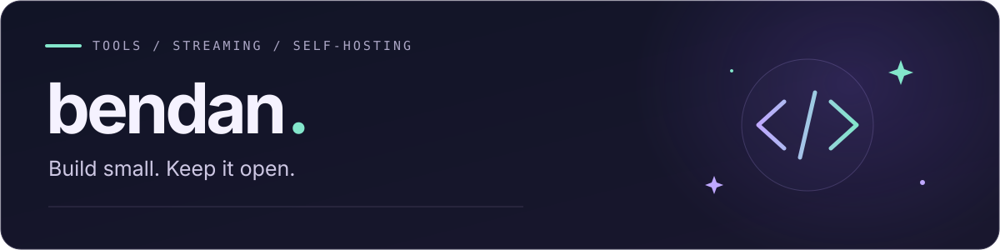

  

### Hi, I'm bendan — 撒谎的笨蛋

I tinker with streaming tools, self-hosted software, and the space where hardware meets code.

把遇到的小问题，做成可以复用的小工具。

[Explore my repositories](https://github.com/1728643928?tab=repositories) · [Email](mailto:love@cherish.pub)

---

## Featured project

### [GPU Encoder Bridge for OBS](https://github.com/1728643928/obs-gpu-encoder)

**Your rendering GPU and encoding GPU don't have to be the same.**

Choose an AMD encoder by its actual GPU name while keeping OBS on your rendering GPU. Use OBS's own streaming controls, with a four-language Windows installer and complete, forkable source.

**Windows x64 · OBS 33.x · AMD AMF · Preview**

[Download & releases](https://github.com/1728643928/obs-gpu-encoder/releases) · [Source](https://github.com/1728643928/obs-gpu-encoder) · [中文说明](https://github.com/1728643928/obs-gpu-encoder/blob/main/docs/README.zh-CN.md) · [Contribute](https://github.com/1728643928/obs-gpu-encoder/blob/main/CONTRIBUTING.md)

---

## Things I like exploring

- **Streaming & hardware** — OBS, GPU encoding, and making the pieces work together.
- **Self-hosting & networking** — practical setups and small experiments.
- **AI & creative tools** — ideas that are worth trying and useful enough to keep.

Small projects. Public source. Room for someone else to carry them forward.
